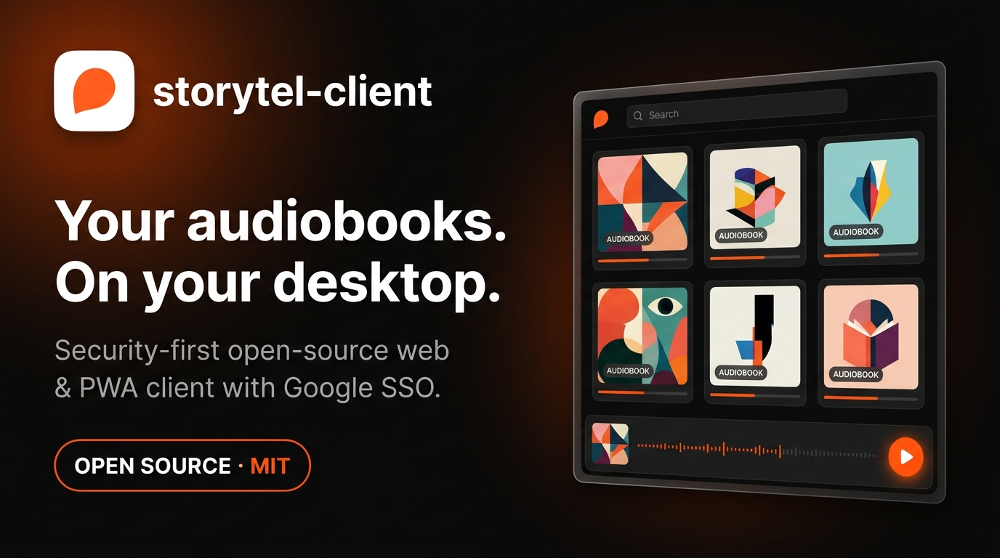

<div align="center">



# storytel-client

**A modern, security-first unofficial Storytel audiobook client for desktop browsers & PWA.**

Built with Next.js App Router, React 19, TypeScript, and Tailwind CSS v4 — designed with Storytel's signature warm editorial aesthetic, native Light & Dark themes, Google SSO support, offline MP3 downloads, custom collections, and seamless mobile position sync.

<p align="center">
  
  
  
  
</p>

</div>

---

## Features

- **Google SSO Authentication:** Opens your real installed Chrome/Edge browser in an isolated profile (no automation flags, so Google OAuth never blocks it), captures the Storytel session & Firebase refresh token automatically, and closes the login window.
- **Email & Password Fallback:** Optional legacy sign-in where your password is only used in-transit and **never written to disk**.
- **Authentic Storytel UI + Light & Dark Themes:** Warm editorial cream (`#FAF7F2`) and charcoal dark (`#141210`) themes with Storytel orange (`#FF5500`), serif headings, square audiobook covers with format badges, and a featured **Continue Listening** hero card.
- **Bilingual Interface (`TR` / `EN`):** Instant one-click Turkish and English language switching.
- **Full-Featured Persistent & Expandable Player:**
  - HTTP `Range`-capable audio proxy for instant seeking (and automatic local playback when downloaded).
  - Expandable mobile-style full-screen player + slim mini player bar.
  - Playback speed control (`0.5x` – `3.0x`) persisted across sessions.
  - Sleep timer (`5–60 min` + **Stop at End of Chapter**).
  - Chapter list navigation & Storytel-synced manual bookmarks.
  - Automatic playback position sync with your phone (periodic + pause + tab close via `sendBeacon`).
  - Hardware media keys & lock screen metadata via the **Media Session API**, plus keyboard shortcuts (`Space`, `←/→`, `M`).
- **Smart Library & Custom Groups:**
  - Filter by status (*Listening*, *Saved*, *Finished*), sort by recent/title/progress/duration, and search inside your bookshelf.
  - **Favorites (Likes)** and **Custom Groups / Collections** with custom colors to organize your audiobooks however you like.
- **Advanced Catalog Search:** Filter Storytel catalog results by **language**, **category**, **duration** (`<5h`, `5–12h`, `12h+`), and **e-book availability**, with one-click play or add-to-bookshelf.
- **Offline MP3 Downloads & Listening Stats:** Download audiobooks locally with live progress tracking, disk usage overview, and a 7-day listening activity chart.
- **PWA Desktop App:** Install directly from Chrome/Edge's address bar to run in its own standalone desktop window without Electron's ~200 MB RAM overhead.

---

## Security Architecture

`storytel-client` was built from scratch with local security as a first-class requirement:

| Security Control | Implementation |
|---|---|
| **Localhost-Only Binding** | Next.js binds strictly to `127.0.0.1:3000` — never exposed to your LAN (`0.0.0.0`). |
| **Encrypted Session Storage** | Session tokens are encrypted at rest with **AES-256-GCM** using a randomly generated 256-bit key (`.data/.master.key`, `0600`) in `.data/session.enc`. |
| **Zero Password Persistence** | Passwords are never saved to disk or cookies. |
| **HttpOnly Session Cookie** | Raw Storytel/Firebase tokens never reach the browser (`localStorage` is never used for tokens). The browser only receives an `HttpOnly; SameSite=Strict` session identifier. |
| **Strict Auth Guards** | Every API endpoint validates the server-side encrypted session and returns `401 Unauthorized` if unauthenticated. |
| **Direct Storytel Traffic Only** | Zero telemetry, zero analytics, zero third-party proxy servers. Traffic goes directly from your machine to `api.storytel.net`, `www.storytel.com`, and `securetoken.googleapis.com`. |

---

## Requirements

- **Node.js 22+** (Node 24 recommended — uses native `fetch` & `WebSocket` with zero heavy browser binaries)
- **Google Chrome** or **Microsoft Edge** installed (for Google SSO sign-in)
- An active **Storytel** subscription

---

## Quick Start

```bash
# 1. Clone the repository
git clone https://github.com/<your-username>/storytel-client.git
cd storytel-client

# 2. Install dependencies
npm install

# 3. Build & start (production mode — fastest)
npm run build
npm run start
```

Or run in development mode:

```bash
npm run dev
```

Open **`http://127.0.0.1:3000`** in your browser and click **Sign in with Google**.

> **Tip (Desktop App Experience):** In Chrome or Edge, click the **Install App (PWA)** icon in the address bar to launch `storytel-client` as a standalone desktop window.

---

## Keyboard Shortcuts

| Key | Action |
|---|---|
| `Space` | Play / Pause |
| `←` | Rewind 15 seconds |
| `→` | Forward 30 seconds |
| `M` | Mute / Unmute |
| Media Keys | Play, Pause, Seek (via Web Media Session API) |

---

## Scripts & Testing

```bash
npm run typecheck   # Run TypeScript compiler checks (tsc --noEmit)
npm test            # Run unit, security, mock API & live E2E smoke tests (19 tests)
npm run build       # Production Next.js build
npm run start       # Start production server on 127.0.0.1:3000
```

---

## Project Structure

```text
src/
├── app/
│   ├── api/                # Route Handlers (auth, bookshelf, search, stream, bookmarks, downloads, collections, stats)
│   ├── globals.css         # Storytel Light & Dark theme tokens
│   ├── layout.tsx          # Fonts (Lora + Plus Jakarta Sans) & PWA metadata
│   └── page.tsx            # Entry point
├── components/
│   ├── PreferencesContext.tsx  # TR/EN i18n + Light/Dark theme state
│   ├── PlayerContext.tsx       # Persistent audio engine, Media Session, sleep timer & sync
│   ├── StorytelApp.tsx         # Main bookshelf, Continue Listening hero & custom groups
│   ├── PlayerBar.tsx           # Mini player + Storytel mobile-style expanded player
│   ├── SearchView.tsx          # Catalog search with language/category/duration filters
│   ├── BookDetailModal.tsx     # Synopsis, chapters, bookmarks, downloads & group assignment
│   ├── StatsAndDownloadsView.tsx
│   └── LoginView.tsx           # Google SSO & email fallback
└── lib/
    ├── crypto.ts           # AES-256-GCM encryption & log redaction
    ├── session.ts          # Encrypted server-side session & HttpOnly cookie management
    ├── sso-browser.ts      # Native Chrome/Edge CDP Google SSO capturer
    ├── local-store.ts      # Favorites, custom groups & listening stats
    ├── downloads.ts        # Offline MP3 download manager
    └── storytel/           # Typed Storytel API client (api.storytel.net + single-flight token refresh)
tests/                      # Unit, crypto, API client & live E2E smoke tests
```

---

## Disclaimer

This is an **unofficial, independent open-source client** created for personal use and is not affiliated with, endorsed by, or connected to Storytel AB. Storytel and its trademarks belong to Storytel AB. You must have a valid Storytel account to use this application.

## License

MIT — see [LICENSE](LICENSE) for details.
