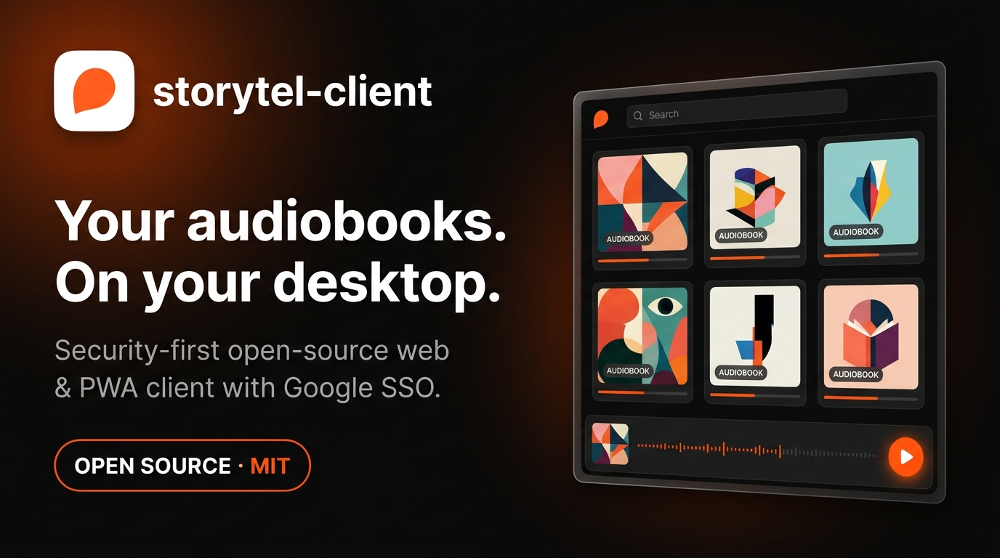

<p align="right">
  <a href="README.md">English</a> • <b>Türkçe</b>
</p>

<div align="center">



# storytel-client

**Masaüstü için modern, güvenli ve zengin özellikli bağımsız Storytel istemcisi & PWA.**  
*Bölünmüş Ekran "Oku & Dinle" stüdyosu, çok dilli kelime defteri, kişiselleştirilmiş kitap önerileri ve çevrimdışı indirme özellikleri ile masaüstü Storytel deneyimi.*

<p align="center">
  <a href="https://www.npmjs.com/package/storytel-client"></a>
  <a href="https://www.npmjs.com/package/storytel-client"></a>
  <a href="https://github.com/onursercanyilmaz/storytel-client/releases"></a>
  
  
  
  
  
</p>

<p align="center">
  <a href="https://www.npmjs.com/package/storytel-client">
    
  </a>
</p>

</div>

> [!IMPORTANT]
> **Aktif Storytel Aboneliği Gereklidir**  
> Bu uygulama resmi Storytel hesabınız ve API'leri üzerinden çalışır. Sesli kitapları dinlemek, e-kitapları okumak veya indirmek için **aktif bir Storytel aboneliğine sahip olmanız gerekir**.  
> *(Uygulama bağımsız, açık kaynaklı bir masaüstü arayüzüdür; abonelik gereksinimlerini atlamaz veya korsan içerik barındırmaz).*

---

## ⚡ npm ile Tek Komutla Başlatın (`npx` / `npm i`)

Kaynak kodu klonlamadan doğrudan terminalinizden çalıştırabilirsiniz (Node.js 20+ gerektirir):

```bash
# npx ile kurulum yapmadan anında çalıştırın
npx storytel-client

# Veya npm i ile global olarak kurun
npm i -g storytel-client
storytel-client --port 3000
```

**CLI Parametreleri:** `--port <sayı>` (varsayılan `3000`), `--no-open` (tarayıcıyı otomatik açma), `--help`.  
Şifreli oturumunuz, profilleriniz, kelime defteriniz ve çevrimdışı MP3'leriniz güvenle `~/.storytel-client` dizininde saklanır. Masaüstü kurulum paketleri (`.exe`, `.deb`, `.AppImage`, `.dmg`) için [Releases](https://github.com/onursercanyilmaz/storytel-client/releases) sayfasını ziyaret edebilirsiniz.

---

## 💡 Neden Bu Projeyi Yaptık?

Resmi Storytel hizmeti geniş bir kütüphaneye sahip olmasına rağmen masaüstü kullanıcıları için büyük eksiklikler barındırır:

1. **Web'de Dinleme ve Okuma Yok:** Resmi Storytel web sitesi masaüstü tarayıcılarda kitap dinlemeye veya e-kitap okumaya izin vermez; bu özellikler **yalnızca mobil uygulamalarla sınırlandırılmıştır**. Masaüstünde çalışırken sürekli telefona bağımlı kalırsınız.
2. **Aynı Anda "Oku & Dinle" Deneyimi Yok:** Resmi mobil uygulamada dahi bir eseri ya sadece dinleyebilir ya da sadece okuyabilirsiniz. Özellikle yabancı dil öğrenirken veya odaklanarak okurken metni takip edip profesyonel seslendirmeyi aynı anda dinlemek (Split-Screen) mümkün değildir.
3. **Entegre Çok Dilli Sözlük & Kelime Defteri Yok:** Yabancı dilde kitap okurken bilmediğiniz bir kelimeye çift tıklayıp anında Türkçe/İngilizce ve 100+ dilde anlamını görmek, sesli telaffuzunu dinlemek ve bunu daha sonra tekrar etmek üzere **Anki** veya **CSV** kartı olarak kaydetmek resmi ekosistemde bulunmaz.
4. **Kitaplığa Özel Akıllı Öneri & Keşif Yok:** Web üzerinde dinleme alışkanlıklarınıza, kitaplığınızdaki yazarlara ve türlere göre hazırlanmış kişiselleştirilmiş bir keşif vitrini sunulmaz.
5. **Kendi Dosyalarını Eşleme & İndirme:** Bilgisayarınızdaki herhangi bir PDF veya EPUB dosyasını sesli kitapla senkronize okuma imkânı veya kitapları çevrimdışı arşivlemek üzere dosya boyutunu görerek doğrudan `.epub` ve `.mp3` olarak kaydetme seçeneği sunulmaz.

**`storytel-client`**, geçerli Storytel aboneliğinizi masaüstünün büyük ekran konforu, klavye kısayolları, bölünmüş ekran okuma & dinleme stüdyosu ve dil öğrenme araçlarıyla birleştiren bağımsız, modern bir masaüstü oynatıcısı olarak bu ihtiyaçtan doğdu.

---

## Öne Çıkan Özellikler

### 1. 📖🎧 Oku & Dinle (Bölünmüş Ekran Stüdyosu)
Aynı eserin hem sesli kitabını dinleyip hem de e-kitabını yan yana okuyabileceğiniz stüdyo modu:
- **Akıllı Ses Senkronizasyonu (Audio Sync):** Sesli kitap çaldıkça e-kitap metninde ilgili bölüme otomatik akıcı kaydırma.
- **Kişiselleştirilebilir Okuma Deneyimi:** Sepia, Koyu (Dark) ve Açık (Light) tema seçenekleri; Serif veya Sans yazı tipi; dinamik yazı boyutu ayarı.
- **Yerel Dosya Desteği:** Storytel kataloğunda e-kitabı olmayan bir sesli kitap dinlerken dahi bilgisayarınızdan dilediğiniz `.epub` veya `.pdf` dosyasını sürükleyip bırakarak sesle birlikte okuyabilirsiniz.

### 2. 🌍 Çok Dilli Kelime Çevirisi & Kelime Defteri (Vocabulary Builder)
Yabancı dilde kitap okurken bilmediğiniz kelimeleri anında öğrenin ve kaydedin:
- **Çift Tıkla Anında Çeviri:** Metindeki herhangi bir kelimeye çift tıkladığınızda veya fareyle seçtiğinizde anında çeviri penceresi açılır.
- **Akıllı Dil Eşleştirmesi:**
  - **İngilizce Kitaplar:** İngilizce ➔ Türkçe (`EN ➔ TR`) çeviri, IPA fonetik telaffuz ve İngilizce tanım.
  - **Türkçe Kitaplar:** Türkçe ➔ İngilizce (`TR ➔ EN`) karşılık.
  - **Diğer Dünya Dilleri (Almanca, Fransızca, İspanyolca, Rusça, İsveççe vb.):** Kitabın orijinal dilinden doğrudan Türkçeye (`DE ➔ TR`, `FR ➔ TR`, `ES ➔ TR`...) çeviri.
  - **Tek Tıkla Dil Değiştirme (⇄):** Çeviri penceresinden hedef dili anında Türkçe ile İngilizce arasında değiştirebilme.
- **Doğal Sesli Telaffuz:** Kelimenin orijinal dilinde Web Speech API üzerinden anında sesli dinleme.
- **Kelime Defterim & Flashcard:** Kaydettiğiniz tüm kelimeleri çalışma kartları olarak tekrar edebilir, "Öğrenildi" olarak işaretleyebilir ve tek tıkla **Anki** veya **CSV** formatında dışa aktarabilirsiniz.

### 3. ✨ Kitaplığa Göre Kişiselleştirilmiş Öneriler (Akıllı Keşif)
- **Kişiselleştirilmiş Öneri Motoru:** Kitaplığınızdaki eserler, en çok dinlediğiniz yazarlar ve kategoriler analiz edilerek henüz kitaplığınıza eklemediğiniz benzer eserler ana arama sayfasında vitrine çıkarılır.
- **Öneri Nedenleri:** Her kartın üstünde öneri gerekçesi belirtilir (örn. *✨ Kitaplığındaki "Aklından Bir Sayı Tut" yazarı John Verdon'dan*).
- **Hızlı Keşif Çipleri:** Kitaplığınızdan derlenen yazar ve tür etiketlerine (`👤 Yazar`, `🏷️ Kategori`) tek tıkla basarak arama yapabilirsiniz.

### 4. 💾 Dosya Boyutu Göstergeli İndirmeler (EPUB, MP3, PDF)
- **Önceden Boyut Göstergesi:** İndirme yapmadan önce butonun üzerinde dosyanın yaklaşık veya gerçek boyutu gösterilir (`MP3 İndir (~370 MB)`, `EPUB İndir (8.2 MB)`).
- **EPUB İndirme:** E-kitabı bulunan eserlerde hem detay penceresinden hem okuma ekranından orijinal `.epub` dosyasını tek tıkla bilgisayarınıza indirebilirsiniz.
- **MP3 İndirme:** Sesli kitapları doğrudan `.mp3` ses dosyası olarak indirebilir ve çevrimdışı dinleyebilirsiniz.
- **PDF Olarak Kaydet / Yazdır:** E-kitap bölümlerini özel `@media print` mizanpajı ile temiz kitap düzeninde PDF olarak kaydedebilir veya yazdırabilirsiniz.

### 5. 🔒 Güvenli Google SSO & Sıfır Şifre Saklama
- **Google ile Giriş (Chrome/Edge CDP):** Gerçek Chrome veya Edge tarayıcınızda izole bir oturum açarak Google OAuth doğrulaması yapar; bot korumasına takılmaz.
- **AES-256-GCM Şifreleme:** Oturum jetonları yerel diskte 256-bit AES-GCM ile şifrelenir (`.data/session.enc`).
- **Sıfır Düz Metin Şifre:** Şifreniz asla diske veya çerezlere yazılmaz. Tarayıcı yalnızca `HttpOnly; SameSite=Strict` oturum çerezi alır.

### 6. 🎛️ Profesyonel Ses Oynatıcı & Mobil Senkronizasyon
- **Kaldığın Yerden Devam Et:** Telefonunuzda dinlediğiniz son saniye anında masaüstüyle senkronize olur (`sendBeacon` + periyodik senkronizasyon).
- **Hız Kontrolü:** `0.5x` ile `3.0x` arasında hassas hız ayarı.
- **Uyku Zamanlayıcısı:** 5–60 dakika veya "Bölüm Sonunda Durdur".
- **Medya Tuşları & Kısayollar:** Klavyedeki Space, ok tuşları (`←/→`) ve işletim sistemi medya tuşları (Web Media Session API) tam uyumludur.

---

## Ekran Görüntüleri & Görünüm

| Aydınlık Tema (Light Editorial) | Koyu Tema (Charcoal Dark) |
|:---:|:---:|
| Sıcak krem (`#FAF7F2`) ve Storytel Turuncusu (`#FF5500`) | Göz yormayan koyu gri (`#141210`) ve yüksek kontrast |

| Oku & Dinle (Split-Screen) | Kelime Defteri & Çeviri |
|:---:|:---:|
| Sol: E-kitap / PDF, Sağ: Sesli Kitap & Senkronizasyon | Çift tıkla sözlük, sesli telaffuz ve flashcard |

---

## Hızlı Başlangıç

### Gereksinimler
- **Node.js 20+** (Node.js 22 veya 24 önerilir)
- **Google Chrome** veya **Microsoft Edge** (Google ile giriş için)
- **Aktif Storytel Aboneliği**

### Kurulum ve Çalıştırma

```bash
# 1. Depoyu klonlayın
git clone https://github.com/onursercanyilmaz/storytel-client.git
cd storytel-client

# 2. Bağımlılıkları yükleyin
npm install

# 3. Üretim sürümünü derleyin ve başlatın
npm run build
npm run start
```

Tarayıcınızda **`http://127.0.0.1:3000`** adresini açın ve **Google ile Giriş Yap** butonuna tıklayın.

> **PWA Masaüstü Uygulaması İpucu:**  
> Chrome veya Edge adres çubuğundaki **"Uygulamayı Yükle"** simgesine tıklayarak uygulamayı Electron'un getirdiği 200+ MB RAM yükü olmadan bağımsız bir masaüstü penceresi olarak kullanabilirsiniz.

---

## Klavye Kısayolları

| Tuş | İşlev |
|---|---|
| `Space` | Oynat / Duraklat |
| `←` | 15 saniye geri sar |
| `→` | 30 saniye ileri sar |
| `M` | Sesi kapat / aç (Mute) |
| `Ctrl + K` / `Cmd + K` | Katalog içi hızlı arama penceresini aç |
| Medya Tuşları | Oynat, duraklat, şarkı/bölüm atla |

---

## Geliştiriciler İçin Kılavuz (Developer Guide)

`storytel-client`, modern web standartları ve katı yerel güvenlik ilkeleriyle geliştirilmiştir.

### Teknoloji Yığını & Mimari

- **Framework:** Next.js 15.5 (App Router, Server Actions, Route Handlers)
- **UI:** React 19, Tailwind CSS v4, Lucide Icons
- **E-Kitap Ayrıştırıcı:** Sıfır harici bağımlılık! Node.js yerel `zlib` akışı ile hafıza dostu ZIP / EPUB ayrıştırma ve sanitize edilmiş HTML üretimi (`src/lib/epub-parser.ts`).
- **Şifreleme Motoru:** Web Crypto & Node.js `crypto` modülü ile AES-256-GCM authenticated encryption (`src/lib/crypto.ts`).
- **Storytel API Motoru:** Typed client, otomatik tek uçuşlu (single-flight) Firebase token yenileme (`securetoken.googleapis.com`), 401 retry döngüsü ve HTTP Range ses akış vekili (`src/lib/storytel/client.ts`).
- **Veri Depolama:** `.data/` dizininde şifrelenmiş JSON depoları (`session.enc`, `vocabulary.json`, `collections.json`, `stats.json`).

### Geliştirme Komutları

```bash
npm run dev        # Geliştirici sunucusunu başlatır (Hot-reload)
npm run build      # Next.js optimize üretim derlemesi
npm run start      # Üretim sunucusunu 127.0.0.1:3000 üzerinde başlatır
npm test           # 22 birim, güvenlik, kripto, mock API ve E2E testini çalıştırır
npm run typecheck  # TypeScript tip denetimi (tsc --noEmit)
```

### Dizin Yapısı

```text
storytel-client/
├── src/
│   ├── app/
│   │   ├── api/
│   │   │   ├── auth/              # Google SSO başlatma/durum/çıkış ve e-posta girişi
│   │   │   ├── books/[id]/        # Kitap detayları, bölümler, yer imleri, formatlar ve boyut tespiti
│   │   │   ├── bookshelf/         # Kitaplık listeleme, ekleme, çıkarma
│   │   │   ├── downloads/         # Çevrimdışı MP3 indirme yöneticisi & dosya akışı
│   │   │   ├── ebook/             # Storytel EPUB akışı, ayrıştırma ve indirme
│   │   │   ├── recommendations/   # Kitaplığa benzer kişiselleştirilmiş öneri motoru
│   │   │   ├── search/            # Çok filtreli katalog araması
│   │   │   ├── stream/[id]/       # HTTP Range destekli ses akış proxy'si
│   │   │   └── vocabulary/        # Kelime defteri CRUD & MyMemory + GTX çok dilli çeviri
│   │   ├── globals.css            # Storytel açık ve koyu tema değişkenleri
│   │   ├── layout.tsx             # Fontlar (Lora + Plus Jakarta Sans) ve PWA ayarları
│   │   └── page.tsx               # Ana giriş sayfası
│   ├── components/
│   │   ├── StorytelApp.tsx        # Ana kitaplık, hero kartı, sekme yönetimi
│   │   ├── ReadAndListenView.tsx  # Bölünmüş ekran Oku & Dinle stüdyosu, sözlük popup'ı
│   │   ├── VocabularyView.tsx     # Kelime defteri, flashcard'lar, telaffuz, Anki dışa aktarma
│   │   ├── BookDetailModal.tsx    # Kitap özeti, MP3/EPUB indirme (boyut etiketli), bölümler
│   │   ├── PlayerBar.tsx          # Mini çalar ve tam ekran genişleyen oynatıcı
│   │   ├── PlayerContext.tsx      # Ses motoru, Media Session ve konum senkronizasyonu
│   │   └── SearchView.tsx         # Kişiselleştirilmiş öneriler ve filtreli arama
│   └── lib/
│       ├── crypto.ts              # AES-256-GCM şifreleme ve URL log temizleme
│       ├── session.ts             # Şifreli sunucu oturumu ve HttpOnly çerez yönetimi
│       ├── epub-parser.ts         # Sıfır bağımlılıklı akışlı EPUB ayrıştırıcı
│       ├── local-store.ts         # Beğeniler, özel koleksiyonlar, kelime defteri ve istatistikler
│       ├── downloads.ts           # MP3 indirme işleyicisi
│       └── storytel/              # Storytel API istemcisi ve TypeScript tipleri
└── tests/                         # 22 kapsamlı test dosyası
```

### Güvenlik Mimarisi Özeti

| Güvenlik Kuralı | Uygulama |
|---|---|
| **Yalnızca Localhost Bağlantısı** | Sunucu kesinlikle `127.0.0.1:3000` adresine bağlanır; yerel ağa (`0.0.0.0`) açılmaz. |
| **AES-256-GCM Şifreleme** | Oturum token'ları `.data/session.enc` dosyasında 256-bit rastgele anahtar ile şifrelenir. |
| **HttpOnly Çerez Koruması** | Storytel veya Firebase token'ları hiçbir zaman istemci tarafı JavaScript'e verilmez (`localStorage` kullanılmaz). |
| **Sıfır Telemetri & Doğrudan İletişim** | Araya giren üçüncü taraf sunucu yoktur; istekler doğrudan `api.storytel.net`, `fastly-ng.storytel.net` ve Google Firebase uç noktalarına iletilir. |

---

## Yasal Uyarı / Disclaimer

Bu yazılım **bağımsız, açık kaynaklı ve resmi olmayan bir istemcidir**. Storytel AB ile herhangi bir kurumsal bağlantısı, sponsorluğu veya ortaklığı bulunmamaktadır. Storytel ticari markaları ve telif hakları Storytel AB'ye aittir.

Bu uygulamayı kullanabilmek için **geçerli ve aktif bir Storytel aboneliğine sahip olmanız yasal bir gerekliliktir**.

---

## Lisans

[MIT](LICENSE) © 2026 onursercanyilmaz
